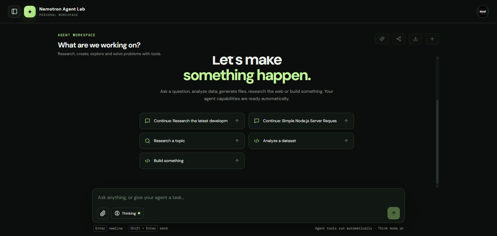

# Nemotron Agent Lab — MERN Monorepo

A full-stack Agent Lab interface for NVIDIA Nemotron 3.5 Super VL, built with React, Vite, Express, and MongoDB.

## Features

- Workspace color themes (Forest, Midnight, Ocean, Amethyst, Nord, Solarized) with a theme picker in Personalization, persisted across sessions.
- Personalization and persistent memory with editable long-term memory.
- Autonomous task planning with up to 12 steps, dependency validation, and explicit task-state transitions.
- Live progress updates, thinking trace, and bounded self‑correction for tool failures.
- Cloudflare Workers AI image generation (FLUX.1 Schnell) with binary validation and File Library storage.
- OAuth authentication (Google, GitHub, Discord) with secure HttpOnly cookies.
- Web search via Tavily API.
- Automatic Python dependency installation in sandboxed execution.

## Demo



## Stack

- **Frontend**: React 19 + Vite static build
- **Backend**: Express API + Mongoose + OAuth + Agent runtime
- **Database**: MongoDB
- **Model**: NVIDIA Nemotron 3.5 Super VL 120B

## Prerequisites

- Node.js `^20.19.0` or `>=22.12.0`
- npm 10+
- MongoDB instance
- (Optional) Cloudflare Workers AI account for image generation
- (Optional) Tavily API key for web search

## Installation

1. Clone the repository
2. Install dependencies: `npm install`
3. Copy the example environment file: `cp .env.example .env`
4. Fill in required environment variables (see below)
5. Run the development server: `npm run dev`

## Environment Variables

| Variable                       | Description                                                     |
| ------------------------------ | --------------------------------------------------------------- |
| `NVIDIA_API_KEY`               | Your NVIDIA API key (backend‑only)                              |
| `MONGODB_URI`                  | MongoDB connection string                                       |
| `SESSION_SECRET`               | Long, high‑entropy secret for session signing                   |
| `TAVILY_API_KEY`               | Tavily API key (for web search)                                 |
| `CLOUDFLARE_ACCOUNT_ID`        | Cloudflare account ID (Workers AI)                              |
| `CLOUDFLARE_API_TOKEN`         | Workers AI API token                                            |
| `CLOUDFLARE_IMAGE_MODEL`       | Model identifier (e.g., `@cf/black-forest-labs/flux-1-schnell`) |
| `CLOUDFLARE_IMAGE_TIMEOUT_MS`  | Timeout in milliseconds (default 120000)                        |
| `IMAGE_GENERATION_DAILY_LIMIT` | Daily image generation quota (default 8)                        |

## Running the App

- Frontend: `http://localhost:5173`
- Backend: `http://localhost:4000`

## Build for Production

```bash
npm run build
npm start
```

Set `SERVE_STATIC=true` in the backend environment to serve the static frontend files.

## Configuration Details

- Register OAuth callback URLs in Google, GitHub, and Discord developer consoles:
  - Google: `http://localhost:4000/api/auth/google/callback`
  - GitHub: `http://localhost:4000/api/auth/github/callback`
  - Discord: `http://localhost:4000/api/auth/discord/callback`
- In production, use HTTPS and appropriate domain URLs for all callbacks.

## Security

- API keys are backend‑only; never expose them in client‑side code.
- Use HTTPS and `Secure`/`SameSite=None` cookies in production.
- MongoDB is required for persistent storage of accounts, preferences, memories, and chats.
- Apply monitoring, backups, and stricter per‑user quotas before public deployment.

## Contributing

Contributions are welcome! Please refer to the [Contributing Guide](CONTRIBUTING.md) for details.

## License

MIT License

## Contact

For questions or support, please open an issue or reach out via the repository's discussion board.
