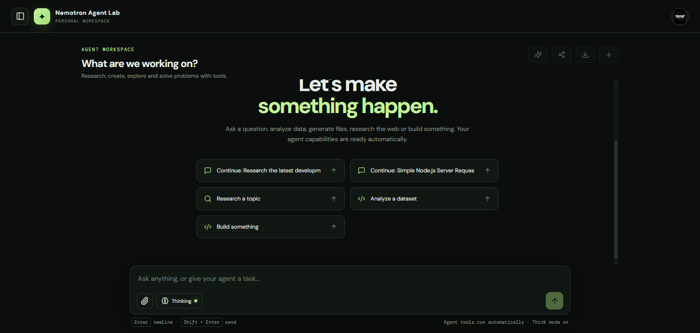

# Nemi v8.5.4 — AI Workspace

A full-stack AI workspace with a conversational assistant, project tools, persistent files, and isolated execution capabilities.

## Features

- Workspace color themes (Forest, Midnight, Ocean, Amethyst, Nord, Solarized) with a theme picker in Personalization, persisted across sessions.
- Personalization and persistent memory with editable long-term memory.
- Automatic model routing and optional manual model selection.
- Model-aware escalation in Auto mode for provider failures and repeated tool recovery failures.
- Native persistent conversation workspaces for source creation, reading, revision-aware editing, search, and requested ZIP packaging.
- Dynamic isolated execution: Python by default when needed, with an optional separately configured Node.js sandbox for builds and tests.
- Backend-authored tool lifecycle events, optional model progress, bounded recovery, and evidence-based artifact verification.
- Cloudflare Workers AI image generation (FLUX.1 Schnell) with binary validation and File Library storage.
- OAuth authentication (Google, GitHub, Discord) with secure HttpOnly cookies.
- Web search via Tavily API.
- Hidden Developer Mode → Personal Integrations for user-owned NVIDIA, Tavily, Cloudflare and Vercel credentials, encrypted at rest.
- Tool controls for Python sandbox, Node.js sandbox, Web search, and Image generation; core project tools remain available automatically.
- Usage analytics across model rounds, conversation branches and regenerated response versions.
- Automatic Python dependency installation in sandboxed execution, without using Python as a routine file-writing bridge.

## Demo



## Overview

Nemi helps users work with conversations, project files, research, generated artifacts, and optional code-execution tools. The interface supports multiple color themes and a persistent File Library for generated files and previously uploaded attachments.

## Stack

- **Frontend**: React 19 + Vite static build
- **Backend**: Express API + Mongoose + OAuth + Agent runtime
- **Database**: MongoDB
- **Model**: NVIDIA Nemotron family via NVIDIA NIM (Auto routing or manual selection)

## Prerequisites

- Node.js `^20.19.0` or `>=22.12.0`
- npm 10+
- MongoDB instance
- (Optional) Cloudflare Workers AI account for image generation
- (Optional) Tavily API key for web search

## Installation

1. Clone the repository
2. Install dependencies: `npm install`
3. Copy the example environment file: `cp .env.example .env`
4. Fill in required environment variables (see below)
5. Run the development server: `npm run dev`

## Environment Variables

| Variable                       | Description                                                     |
| ------------------------------ | --------------------------------------------------------------- |
| `NVIDIA_API_KEY`               | Your NVIDIA API key (backend‑only)                              |
| `MONGODB_URI`                  | MongoDB connection string                                       |
| `SESSION_SECRET`               | Long, high‑entropy secret for session signing                   |
| `USER_INTEGRATIONS_ENCRYPTION_KEY` | 32-byte hex/base64 key for AES-256-GCM Personal Integrations (required only when users save personal credentials) |
| `TAVILY_API_KEY`               | Tavily API key (for web search)                                 |
| `CLOUDFLARE_ACCOUNT_ID`        | Cloudflare account ID (Workers AI)                              |
| `CLOUDFLARE_API_TOKEN`         | Workers AI API token                                            |
| `CLOUDFLARE_IMAGE_MODEL`       | Model identifier (e.g., `@cf/black-forest-labs/flux-1-schnell`) |
| `CLOUDFLARE_IMAGE_TIMEOUT_MS`  | Timeout in milliseconds (default 120000)                        |
| `IMAGE_GENERATION_DAILY_LIMIT` | Daily image generation quota (default 8)                        |
| `VERCEL_NODE_SANDBOX_IMAGE` | Optional isolated Node.js sandbox image; enables `execute_node` |
| `AGENT_MAX_MODEL_ROUNDS` | Maximum model/tool loop rounds (default 96, bounded) |
| `AGENT_MAX_TOOL_CALLS` | Maximum execution tool calls per turn (default 64, bounded) |
| `AGENT_MAX_RECOVERY_ATTEMPTS` | Maximum consecutive failures per tool (default 3, bounded) |

## Running the App

- Frontend: `http://localhost:5173`
- Backend: `http://localhost:4000`

## Build for Production

```bash
npm run build
npm start
```

Set `SERVE_STATIC=true` in the backend environment to serve the static frontend files.

## Configuration Details

- To reveal Developer Mode, open Personalization settings and click the **Personalization** heading seven times. The Developer tab then exposes Personal Integrations. This is a hidden UI shortcut, not a security boundary; API routes still enforce authentication and ownership.
- Generate `USER_INTEGRATIONS_ENCRYPTION_KEY` with `node -e "console.log(require('crypto').randomBytes(32).toString('hex'))"`. Keep it stable and backed up; do not rotate it without re-encrypting existing credentials.
- Auto uses Bolt for task classification, then selects a model using recent user-turn context, AI classification and deterministic capability rules. Current-information requests, web research, explicit tool requests and short follow-ups retain their task context and route to a tool-capable model. Bolt is text-only and never receives tool-requiring tasks. Empty model responses trigger controlled escalation in Auto mode instead of being reported as successful completions. MP3/WAV attachments route to Omni for speech and audio understanding. Manual mode never changes models during a turn. Auto allows one controlled escalation.

- Register OAuth callback URLs in Google, GitHub, and Discord developer consoles:
  - Google: `http://localhost:4000/api/auth/google/callback`
  - GitHub: `http://localhost:4000/api/auth/github/callback`
  - Discord: `http://localhost:4000/api/auth/discord/callback`
- In production, use HTTPS and appropriate domain URLs for all callbacks.

## Security

- API keys are backend‑only; never expose them in client‑side code.
- Use HTTPS and `Secure`/`SameSite=None` cookies in production.
- MongoDB is required for persistent storage of accounts, preferences, memories, and chats.
- Apply monitoring, backups, and stricter per‑user quotas before public deployment.

## Contributing

Contributions are welcome! Please refer to the [Contributing Guide](CONTRIBUTING.md) for details.

## License

MIT License

## Contact

For questions or support, please open an issue or reach out via the repository's discussion board.
